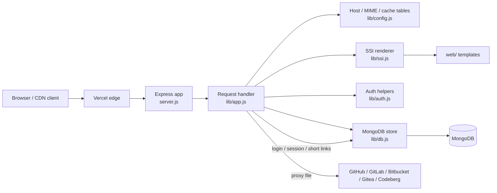
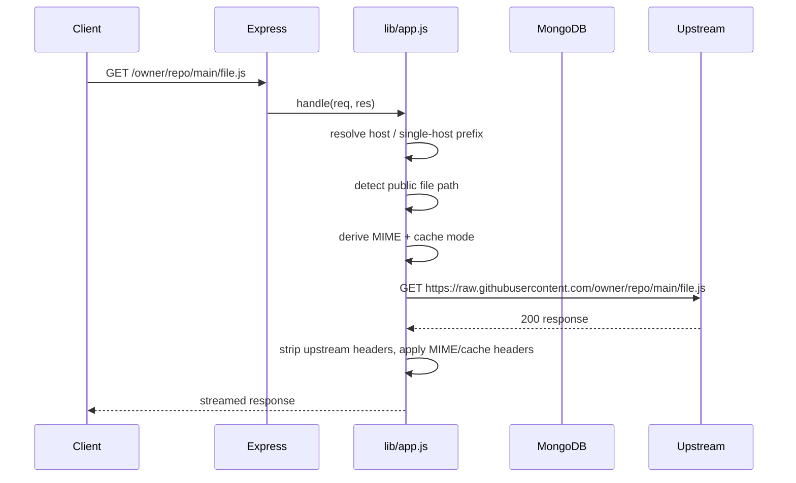
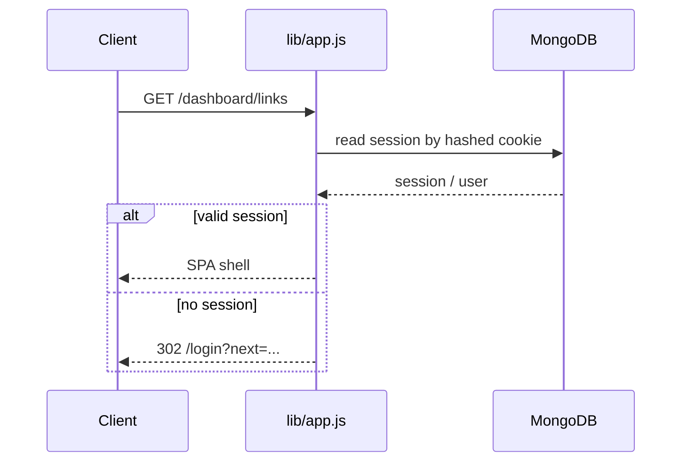
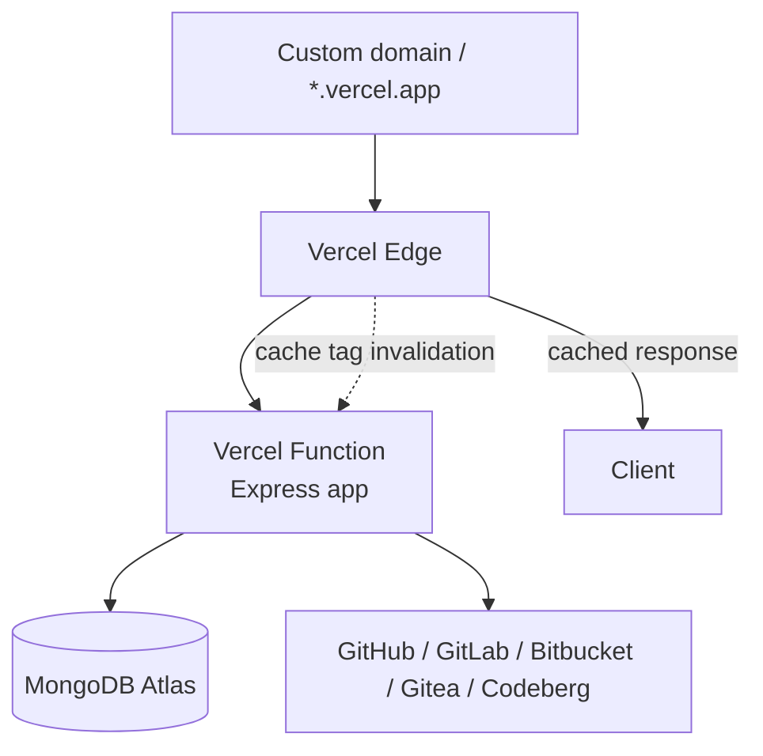

# Architecture

This document describes this repository as a **custom fork** of
[neoascetic/rawgithack](https://github.com/neoascetic/rawgithack). It covers
what changed from the upstream project, how requests move through the system,
the MongoDB data model, the dashboard SPA, caching, and the known limitations.

---

## 1. What changed from upstream

The upstream project is an nginx-based caching proxy. This fork removes that
deployment and implements the same public proxy behaviour as a Vercel/Express
application with MongoDB-backed accounts and short links.

| Area | Upstream | This fork |
| --- | --- | --- |
| Runtime | nginx | Node.js + Express |
| Deployment | Docker/nginx | Vercel Functions (Express preset) |
| Configuration | `rawgithack.conf` | `lib/config.js`, `lib/app.js` |
| Templates | nginx SSI | Small SSI renderer in `lib/ssi.js` |
| Host routing | nginx `server_name` maps | Host maps in `lib/config.js` |
| Single-host mode | Not available | Path prefixes (`/cdn/...`, `/gl/...`) |
| Caching | nginx `proxy_cache` | Vercel CDN + `Cache-Control` / `CDN-Cache-Control` |
| Cache purge | nginx cache + Cloudflare purge | `invalidateByTag()` + `Vercel-Cache-Tag` |
| Authentication | None | MongoDB users + server-side sessions |
| Registration | None | Invite-only links + optional legacy secret |
| Dashboard | None | `/dashboard` SPA |
| Short links | None | `/s/<id>`, random or custom names |
| Admin tools | None | `/dashboard/users`, `/dashboard/invites` |
| HTML safety | SSI phishing notice | Same notice, rendered from templates |
| Legacy proxy paths | `/owner/repo/ref/file` | Kept unchanged |

Removed legacy files:

- `rawgithack.conf`
- `docker/Containerfile`
- `t/` (Test::Nginx suite)
- `.gitattributes` (nginx linguist override)

The GitHub Actions workflow now runs only the Node.js tests.

---

## 2. High-level components



| File | Responsibility |
| --- | --- |
| `server.js` | Express entrypoint; exports the app for Vercel and listens locally when `VERCEL` is unset |
| `lib/app.js` | All routing, proxying, auth, dashboard pages, admin APIs, short links |
| `lib/config.js` | Host→origin maps, MIME table, cache-control rules, hot-file counter |
| `lib/auth.js` | scrypt password hashing, session tokens, cookies, short IDs, secret comparison |
| `lib/db.js` | MongoDB connection singleton and all persistence operations |
| `lib/ssi.js` | Minimal SSI renderer for `web/` templates |
| `web/*.html` | Landing, login, registration, dashboard SPA |
| `web/internal/*` | Shared header/footer, phishing notice, error page, icon, opensearch |
| `vercel.json` | Express preset + bundles `web/**` into the function |

---

## 3. Request lifecycle



The public file path does not require authentication. Protected page/API
requests follow the same pipeline but stop at the authentication stage:



Order of checks in `lib/app.js`:

1. Parse host, path, query, scheme.
2. Resolve host to an upstream origin and CDN/dev mode.
3. Resolve single-host path prefix (`/cdn`, `/gl`, ...) when applicable.
4. Public routes: `/register`, `/login`, `/logout`, `/s/<id>`, `/favicon.svg`,
   `/opensearch.xml`, `/purge` (auth required).
5. Public file paths: valid proxy paths bypass authentication.
6. Authentication: all other routes require a session.
7. Dashboard/admin routes, APIs, landing page, legacy file proxy.

---

## 4. Host and path routing

### Subdomain mode

Enabled when `GITHACK_BASE_DOMAIN` is set (for example `example.com`):

| Host | Origin |
| --- | --- |
| `raw.example.com` | `raw.githubusercontent.com` |
| `rawcdn.example.com` | `raw.githubusercontent.com` (CDN cache mode) |
| `gist.example.com`, `gistcdn.example.com` | `gist.githubusercontent.com` |
| `gl.example.com`, `glcdn.example.com` | `gitlab.com` |
| `bb.example.com`, `bbcdn.example.com` | `bitbucket.org` |
| `gt.example.com`, `gtcdn.example.com` | `gitea.com` |
| `cb.example.com`, `cbcdn.example.com` | `codeberg.org` |

The apex and `www` hosts also resolve as raw hosts. The canonical host is
`GITHACK_CANONICAL_HOST` or `raw.<GITHACK_BASE_DOMAIN>`.

### Single-host mode

Used on `*.vercel.app`, preview deployments, and localhost. Platform and CDN
selection move into the first path segment:

| Path | Meaning |
| --- | --- |
| `/owner/repo/ref/file` | raw development |
| `/raw/owner/repo/ref/file` | raw development |
| `/cdn/owner/repo/ref/file` | raw production |
| `/rawcdn/...` | raw production |
| `/gl/group/repo/raw/ref/file` | GitLab |
| `/glcdn/...` | GitLab production |
| `/gist/...`, `/gistcdn/...` | Gist |
| `/bb/...`, `/bbcdn/...` | Bitbucket |
| `/gt/...`, `/gtcdn/...` | Gitea |
| `/cb/...`, `/cbcdn/...` | Codeberg |

The same prefixes are used by the dashboard-generated URLs.

---

## 5. Public route map

| Route | Auth | Purpose |
| --- | --- | --- |
| `/` | No | Landing page when anonymous; redirects signed-in users to `/dashboard` |
| `/login` | No | Login form (dedicated page) |
| `/logout` | Yes/session | Clears session, redirects to `/login` |
| `/register` | No | Enter an invite code |
| `/register/<token>` | No | One-time registration form |
| `/dashboard` | Yes | SPA shell; client redirects to `/dashboard/links` |
| `/dashboard/links` | Yes | Create/list short links |
| `/dashboard/account` | Yes | Account view |
| `/dashboard/users` | Admin | User list |
| `/dashboard/users/<username>` | Admin | User detail, role, delete |
| `/dashboard/invites` | Admin | Create/revoke invites |
| `/admin` | Admin | Redirects to `/dashboard/users` |
| `/admin/<username>` | Admin | Redirects to `/dashboard/users/<username>` |
| `/<username>` | Self/Admin | Redirects to `/dashboard` or the admin user detail |
| `/s/<id>` | No | Public short link |
| `/favicon.svg` | No | Local SVG icon |
| `/favicon.ico` | No | Redirects to `/favicon.svg` |
| `/opensearch.xml` | No | OpenSearch description |
| `/purge` | Yes | `DELETE` cache-tag invalidation |
| `/api/proxies` | Yes | `GET` list, `POST` create short link |
| `/api/proxies/<id>` | Yes | `DELETE` a short link |
| `/api/admin/users` | Admin | List users |
| `/api/admin/users/<username>` | Admin | `GET`, `PATCH` role, `DELETE` |
| `/api/admin/invites` | Admin | `GET` list, `POST` create |
| `/api/admin/invites/<id>` | Admin | `DELETE` revoke |
| `/owner/repo/ref/file` | No | Legacy/public proxy path |

Dashboard routes are handled by one server-rendered shell; the client router
uses `history.pushState` for subroutes. Direct loads of any `/dashboard/...`
path return the shell, so refreshes and shared links work.

---

## 6. MongoDB data model

Database name: `MONGODB_DB` (default `githack`).

### `users`

```js
{
  _id: ObjectId,
  username: String,        // unique index
  passwordHash: String,    // scrypt$N$r$p$salt$hash
  role: "user" | "admin",
  createdAt: Date,
  updatedAt?: Date
}
```

The username `admin` is always treated as an admin, even if its stored role is
missing or stale. Admin access is also granted by `role: "admin"`.

Password hashing uses Node's `crypto.scrypt` with `N=16384`, `r=8`, `p=1`,
a 16-byte random salt, and a 64-byte derived key.

### `sessions`

```js
{
  _id: String,             // SHA-256 of the cookie token
  username: String,
  expiresAt: Date          // TTL index, expireAfterSeconds: 0
}
```

The raw session token is only in the HttpOnly cookie
`__githack_session`. Sessions are deleted on logout and when a user is deleted.

### `proxies`

```js
{
  _id: String,             // custom 2-64 char name (or legacy random ID)
  url: String,             // original public/source URL
  origin: String,          // upstream host
  path: String,            // upstream path
  search: String,          // query string
  isCdn: Boolean,          // immutable CDN cache mode
  contentType: String,     // MIME type derived at creation
  owner: String,           // username
  createdAt: Date
}
```

Indexes: `{ owner: 1 }`. `_id` uniqueness enforces short-name uniqueness.

### `settings`

```js
{
  _id: "registration",
  usedAt: Date,
  secretHash: String
}
```

Used only by the legacy single-use `REGISTRATION_SECRET` flow.

### `invites`

```js
{
  _id: String,             // SHA-256 of the invite token
  createdBy: String,       // admin username
  createdAt: Date,
  usedAt?: Date,
  usedBy?: String          // username created from the invite
}
```

The raw invite token exists only in the generated registration URL.

---

## 7. Authentication and sessions

1. `POST /login` reads `username`, `password`, `next`.
2. The user document is loaded and the password is verified with scrypt.
3. A 32-byte random token is generated and its SHA-256 hash is stored in
   `sessions` with a 7-day expiry.
4. The raw token is returned as an HttpOnly, SameSite=Lax cookie.
   `Secure` is set when the request is HTTPS.
5. On each protected request, the cookie is hashed, the session is loaded, and
   the user document is fetched. The role is normalized (`admin` username or
   `role: "admin"`).
6. `/logout` deletes the session document and clears the cookie.
7. Deleting a user deletes their sessions and short links.

No public signup exists. Registration is invite-only (below), and admins can
create additional users with `npm run create-user -- <username> <password>
[--admin]`.

---

## 8. Registration and invites

### Admin invites

1. An admin opens `/dashboard/invites`.
2. `POST /api/admin/invites` generates a 24-byte random token.
3. Only its SHA-256 hash is stored in `invites`; the raw token is returned once
   as `/register/<token>`.
4. `/register/<token>` displays the registration form.
5. `POST /register/<token>` validates username/password, atomically reserves the
   invite (`usedAt`/`usedBy`), creates the user, creates a session, and redirects
   to `/dashboard`.
6. Reusing or revoking the invite returns `404`.

### Legacy secret

If `REGISTRATION_SECRET` is set, `/register/<REGISTRATION_SECRET>` also works
once. Consumption is recorded in the `settings` document. Delete that document
to allow another legacy registration.

---

## 9. Short-link lifecycle

### Creation

`POST /api/proxies` (authenticated) accepts:

```json
{
  "url": "https://github.com/user/repo/blob/main/file.js",
  "cdn": true,
  "slug": "my-file"
}
```

- The URL may be one of this instance's public proxy URLs or a supported
  source-host URL.
- `cdn` selects production (immutable) or development caching for source URLs.
- `slug` is optional; if present it must match `[A-Za-z0-9_-]{2,64}` and be
  unique.
- If no slug is supplied, the API returns the legacy public URL on this
  instance and does not create a short-link record.
- The record stores the upstream origin, path, query, MIME type, and cache mode.

### Serving

`GET /s/<id>` is public:

1. Look up the proxy record.
2. Derive the MIME type from the record, falling back to the path extension.
3. Apply the phishing notice for HTML documents.
4. Proxy the upstream file with the same MIME/cache rules as a normal proxy
   response.
5. Use `p<id>` as the Vercel cache tag.

Legacy records without `contentType` fall back to the upstream response type.

### Purging and deletion

- `DELETE /purge?url=<short-url>` invalidates the `p<id>` tag.
- `DELETE /api/proxies/<id>` deletes the record and best-effort invalidates the
  tag.
- Admins can delete users, which also removes their short links and sessions.

---

## 10. MIME types, caching, and phishing notice

- MIME types are derived from the file extension using the table in
  `lib/config.js`, matching the upstream behaviour.
- Text types get `; charset=utf-8`; binary/font/image/archive types do not.
- Browser responses use `Cache-Control` copied from the upstream rules:
  - CDN non-HTML: immutable, one year
  - CDN HTML: private, one day
  - development HTML: private, 60 seconds
  - hot dev files: progressively longer public cache times
  - unknown/error: short public cache
- Vercel-specific caching uses `CDN-Cache-Control` (adds `s-maxage`) and
  `Vercel-Cache-Tag`.
- Hot-file detection is an in-memory per-instance approximation; it is not
  shared across function instances.
- HTML documents requested as browser navigations show a confirmation notice
  unless `__Http-phish=1` is set. Non-document requests and non-HTML files are
  unaffected.

---

## 11. Configuration

| Variable | Purpose |
| --- | --- |
| `MONGODB_URI` | MongoDB connection string; enables auth and short links |
| `MONGODB_DB` | Database name, default `githack` |
| `REGISTRATION_SECRET` | Enables the legacy one-time registration URL |
| `SHORT_LINK_QUOTA` | Per-user short-link quota, default `200` |
| `TRUST_PROXY` | Trust `x-forwarded-*` headers from a reverse proxy |
| `GITHACK_BASE_DOMAIN` | Enables subdomain mode for a custom domain |
| `GITHACK_CANONICAL_HOST` | Canonical/homepage host override |
| `GITHACK_SITE_NAME` | Brand name used in titles and pages |
| `GITHACK_SOURCE_URL` | Footer source-code link |
| `GITHACK_WEB_ROOT` | Template directory, default `web` |
| `PORT` | Local server port, default `3000` |

Without `MONGODB_URI`, the app still proxies public files and serves the legacy
public homepage, but authentication, the dashboard, and short links are
unavailable.

---

## 12. Deployment topology



- `vercel.json` uses the `express` preset and includes `web/**` in the
  function bundle.
- The MongoDB connection is created lazily and cached per function instance.
- Sessions use a TTL index; Atlas network access must allow Vercel's dynamic
  IPs (commonly `0.0.0.0/0`).
- `server.js` exports the Express app for Vercel and listens locally when
  `VERCEL` is unset.

---

## 13. Security notes and limitations

- MongoDB credentials must be provided through environment variables and
  rotated if exposed. They are never stored in the repository.
- Registration is invite-only; invite tokens are stored only as hashes.
- Registration pages set `Referrer-Policy: no-referrer` and `Cache-Control:
  no-store`.
- Sessions are server-side and HttpOnly. HTTPS uses the `__Host-` cookie prefix.
- CSRF exposure is limited by SameSite=Lax cookies and JSON-only admin/proxy APIs.
- The proxy only accepts source URLs from known hosting providers; it is not a
  general-purpose open proxy.
- Proxied HTML/SVG responses are sandboxed with CSP to prevent them from
  reaching the dashboard origin's authenticated APIs.
- Application pages deny framing and send `X-Content-Type-Options: nosniff`.
- Login, registration, purge, short-link and invite creation have in-memory
  rate limits. Add Vercel WAF or a shared limiter for strict cross-instance
  limits.
- Short-link creation has a per-user quota (`SHORT_LINK_QUOTA`, default 200).
- Security-relevant actions are emitted as structured JSON logs.
- Authorization uses the MongoDB `role` field; the username itself is not a
  privilege.
- New usernames are limited to 3-32 letters, numbers or underscore; common
  system names are reserved. Existing legacy usernames can still sign in.
- Short-link cache entries are immutable; purge the tag and hard-refresh the
  browser after changing a previously cached response.
- Hot-file detection is per-instance and therefore approximate.
- Vercel Functions impose platform limits on request/response size and
  execution duration.
- There is no password reset or email verification flow.
- Deleting users is destructive: sessions, proxies, and ownership records are
  removed.

---

## 14. File map

```text
.
├── server.js                 Express entrypoint
├── vercel.json               Vercel configuration
├── package.json
├── .env.example              Environment template
├── ARCHITECTURE.md           This document
├── lib/
│   ├── app.js                Request routing, proxy, auth, APIs, pages
│   ├── auth.js               Password hashing, sessions, tokens, cookies
│   ├── config.js             Host/MIME/cache tables and hot-file counter
│   ├── db.js                 MongoDB store
│   └── ssi.js                SSI renderer
├── scripts/
│   └── create-user.js        CLI user creation (supports --admin)
├── test/
│   └── app.test.js           Node test suite
└── web/
    ├── landing.html          Anonymous landing page
    ├── login.html            Sign-in page
    ├── register-start.html   Invite code entry
    ├── register.html         Invite registration form
    ├── dashboard.html        Dashboard SPA shell
    ├── index.html            Legacy public homepage (no-Mongo mode)
    └── internal/
        ├── pre.html          Shared head/header/theme
        ├── post.html         Shared footer
        ├── error.html        Error page
        ├── phishing-notice.html
        ├── icon.svg
        └── opensearch.xml
```
